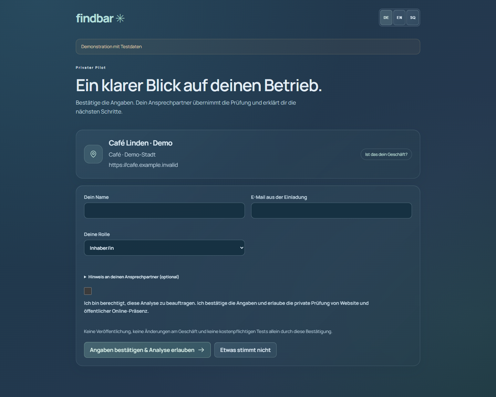
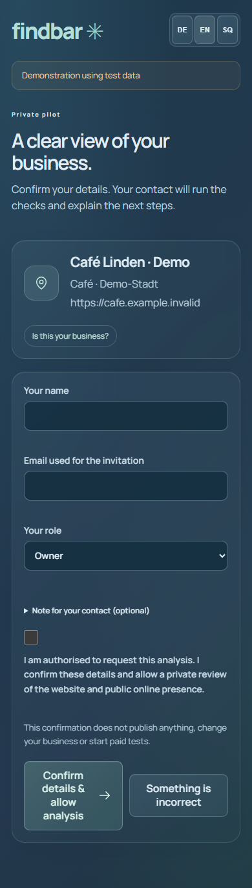
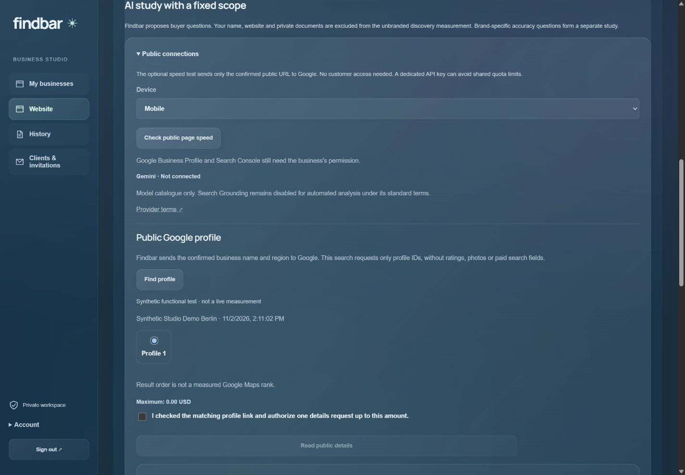

# Findbar

**Assisted business visibility audits — reviewed, understandable and private.**

Findbar helps an operator check a business website and public local presence, review concrete proposals and deliver a simple private client report. It is part of KiDraht.

## Status · 2 November 2026

**Assisted online pilot · Beta / readiness 70 · Owner UAT pending.** This is a public presentation of private implementation work, not a self-service production release.

- Private invitation link; the business confirms its details and permission without entering the operator Studio.
- Operator-led analysis, three understandable priorities, evidence on demand and reviewed report release.
- DE / EN / SQ portal and reports, PDF export and an email draft with PDF attachment.
- Separate invitation/report access, expiry and revocation; retained evidence and version history.
- Generated DE / EN / SQ portfolios offer 30 suggested buyer questions across six intents. Separate designs prepare five exploratory questions, 30 questions in one round, or 12 questions in two rounds. Preparation is free; each live scope requires its own budget approval.
- Bounded public sitemap discovery, Google/Bing crawling-policy checks and evidence-based placeholder detection extend the website audit. Intentional noindex pages do not receive search-description drafts.
- WordPress builder content now supports page-specific browser-title and search-description proposals with saved source evidence, versioned review and copyable DE / EN / SQ implementation instructions. Publication remains manual; demo placeholders and unsupported claims are excluded.
- Owner-only encrypted Places/PageSpeed key setup, ID-only public profile search and separately approved temporary details. Mobile/desktop PageSpeed checks use the worker and keep provider limits separate from website faults. Two dedicated API/IP-restricted keys are configured; free ID-only profile lookup and keyed mobile/desktop PageSpeed are verified live.
- Gemini verifies the model catalogue only; Search Grounding analysis stays disabled under its standard terms. Claude Haiku 5.5 has a tested native parser/fixture preview, with paid live dispatch held until a complete provider cost bound is verified. Existing OpenAI studies are preserved.
- Google OAuth/PKCE adapter implemented and tested with simulated transport. The real Business Profile/Search Console connections are **not yet configured or verified**.

The saved AI sample is kept distinct from new website checks. No claim of guaranteed rankings, AI recommendations or automatic client-site publishing is made.

## Real interface, fictitious demo business

Actual product UI using a visual fixture for “Café Linden · Demo”. No customer data, customer consent or measured business results are shown. The implementation was separately tested with isolated operator/client sessions.

Mobile invitation

Actual operator UI with synthetic test data; no live Google result, customer data or measured Maps rank.

## Verification and limits

The earlier assisted-portal baseline passed 201 unit tests and 42/42 DB/worker checks, followed by 11/11 focused integration checks after PDF/email refinements. The operator/client journey ran over public HTTPS, with desktop/tablet/mobile checks and three-language PDF downloads. The consent used for QA was explicitly synthetic; no customer approval was impersonated and no email was sent.

The public-research baseline passed TypeScript and 219 tests, plus 44 isolated DB/worker checks. The WordPress refinement passed TypeScript and 229 tests, a build, all 45 DB/worker checks and a focused six-proposal/idempotency/tenant-isolation test. Three fresh public website checks were recorded separately from the earlier evidence. No new paid AI call was made for this milestone.

The own-connections refinement passed TypeScript and 238 unit tests, a production build, all 51 isolated DB/worker checks and 9 focused adapter checks. Chrome verified desktop/tablet/mobile and EN/DE/SQ controls with synthetic data. No new paid AI call or customer-site write was made. After a separate scoped approval, four free live Google checks returned HTTP200: two ID-only profile lookups and two PageSpeed device measurements. No profile details or AI calls were purchased. Claude paid live dispatch remains disabled.

The preceding study refinement passed 210 tests. Ten newly authorized live web-search answers were read back through the application with their exact SQ/EN language and response preserved. Preparation is idempotent across snapshot capture times; unused preparation records were revoked before any provider call. No customer identity, media or study result is published here.

Existing owner records, AI studies/costs, encrypted key and original regression export were verified unchanged. Real Business Profile/Search Console access, real client usability feedback and final owner acceptance remain open.

[Portfolio case study](https://www.redioncekrezi.de/en/projects/findbar)
