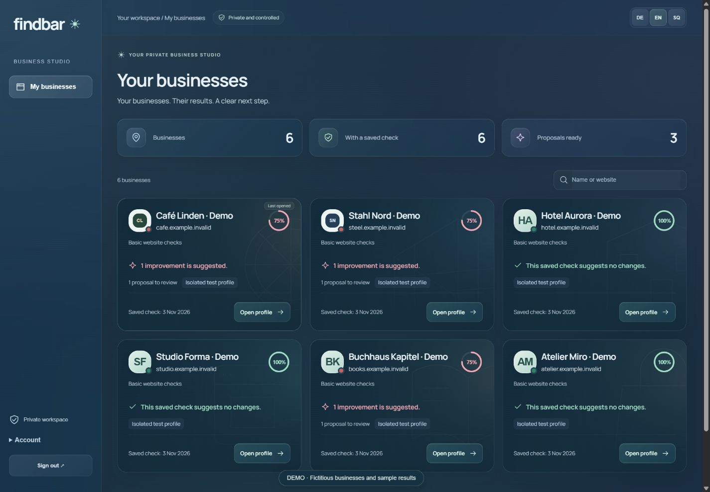
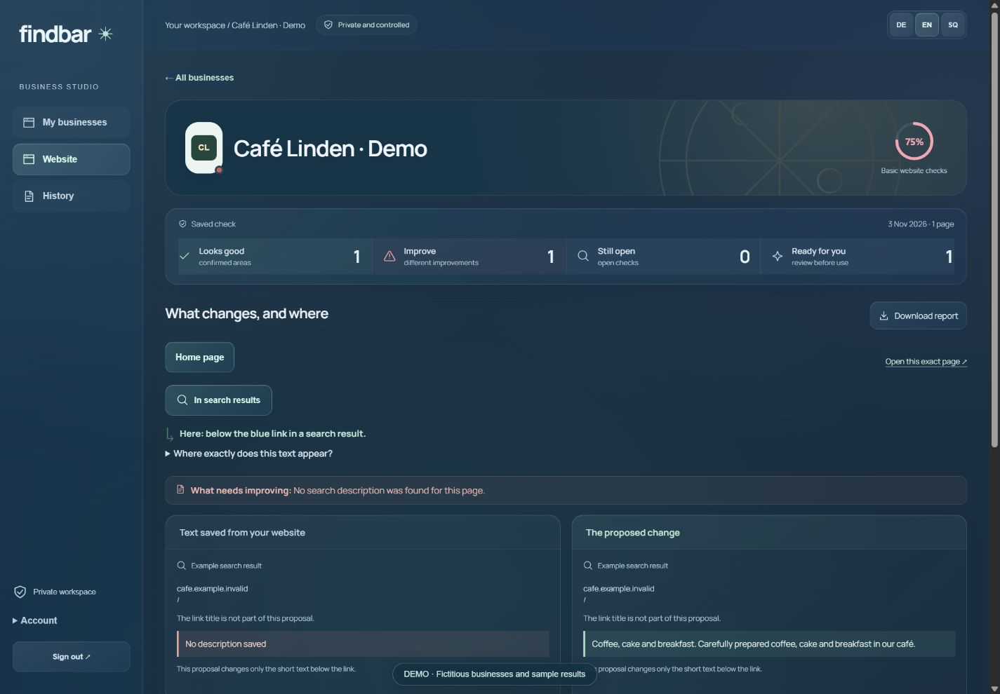
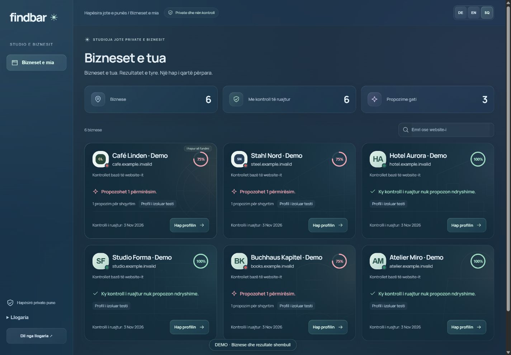
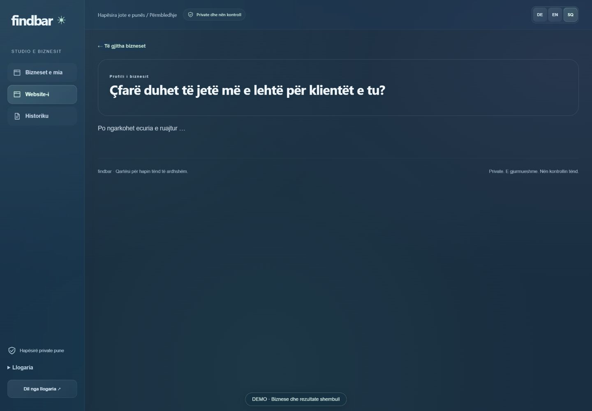
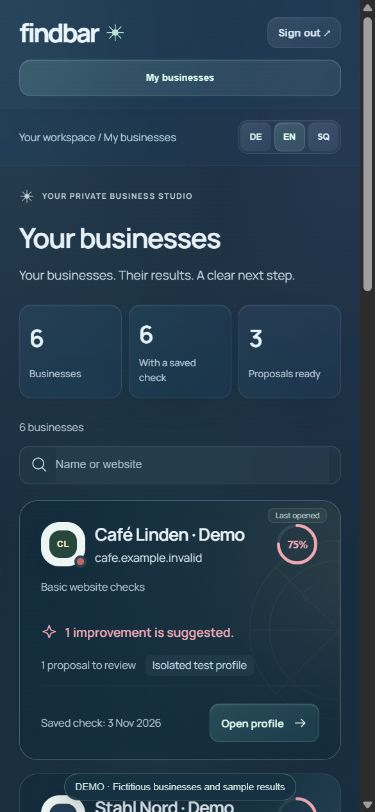
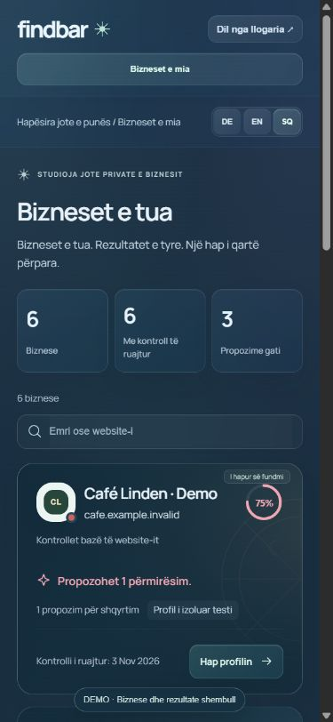

# Findbar

**Your business. Clear findings. A concrete next step.**

A private audit studio by KiDraht — designed for business owners, operated with review and control.

*Actual running product UI. Fictitious businesses and sample results; this image does not present a customer audit.*

## What Findbar does

- **Checks the website:** browser titles, search descriptions, repeated text, crawl instructions and supported content issues, with saved evidence.
- **Shows the exact change:** current text beside the proposed replacement, where it appears, and copyable instructions for the developer. WordPress proposals are page-specific.
- **Reviews public local presence:** read-only Google profile ID lookup and mobile/desktop PageSpeed checks, kept separate from website findings.
- **Runs scoped AI studies:** approved OpenAI web-search questions, traceable answers and citations, a defined budget and preserved original results. A small study is not a global visibility score.
- **Keeps the client journey simple:** a private invitation, confirmation of business details and permission, then a reviewed DE/EN/SQ report. PDF export and an email draft with attachment are available; email is not sent automatically.
- **Retains the history:** source evidence, report versions, proposals, approvals, revocation and expiry. A preview or replay is never labelled a fresh public measurement.

The operator works in the Studio. The client receives the result. Customer-site publication and paid requests retain their own scoped approvals.

See an exact proposed change · English

Synthetic demonstration: the search description changes; the large heading inside the website stays as it is.

## Demonstrim në shqip

Findbar tregon **çfarë është mirë, çfarë duhet përmirësuar dhe çfarë ndryshimi propozohet**. Çdo biznes ka profilin, logon, kopertinën dhe historikun e vet. Detajet hapen kur nevojiten.

Biznesi konfirmon të dhënat përmes një ftese private. Operatori bën kontrollet dhe shqyrton rezultatin; klienti merr raportin e qartë, me PDF dhe përmbledhje emaili.

*UI reale me biznese dhe rezultate shembull. Të dhënat dhe raportet e pilotëve realë mbeten private.*

Shiko ndryshimin konkret · Shqip

Propozimi tregon qartë fushën që ndryshon dhe vendin ku shfaqet. Udhëzimi për zhvilluesin hapet veç dhe mund të kopjohet.

Mobile · EN / SQ

## Status · 3 November 2026

**Assisted pilot · Beta / readiness 70 · Owner UAT pending.**

Website, worker/DB, scoped OpenAI studies, free ID-only Google lookup and mobile/desktop PageSpeed have been exercised. A real correction case completed the proposal → approved implementation → fresh public recheck loop. This is an assisted pilot, not a self-service production launch.

Business branding is currently a reviewed catalogue: existing website logos/covers where available, original category illustrations and monograms otherwise. Automatic brand discovery is planned. Decorations never alter audit scores or evidence.

Real client-owned Google Business Profile/Search Console connections still need the client's access. OAuth/PKCE is tested with simulated transport. Gemini is catalogue-only; grounding analysis is disabled. Claude has a native fixture preview; paid live execution stays held until the complete cost bound is verified. Generic automatic client-site publishing is not connected.

## Verification

The preceding software baseline passed TypeScript, 238 unit tests, a production build and 51 isolated DB/worker checks. Its nine adapter checks and free live Google checks are recorded separately from paid, authorised pilot studies. The current identity/media refinement passed TypeScript, 240 unit tests, a production build and all 51 isolated DB/worker checks, with desktop/tablet/mobile visual review. A deterministic regression now rejects non-canonical approval-token encodings, and the local synthetic media surface is blocked in production.

Original reports and historical records remain intact. The basic website percentage is a count of scoped checks — not a Maps position, a ranking promise or an AI recommendation guarantee. Client feedback and final owner acceptance remain open.

[View the portfolio case study](https://www.redioncekrezi.de/en/projects/findbar) · [Prezantimi në shqip](https://www.redioncekrezi.de/sq/projects/findbar)
