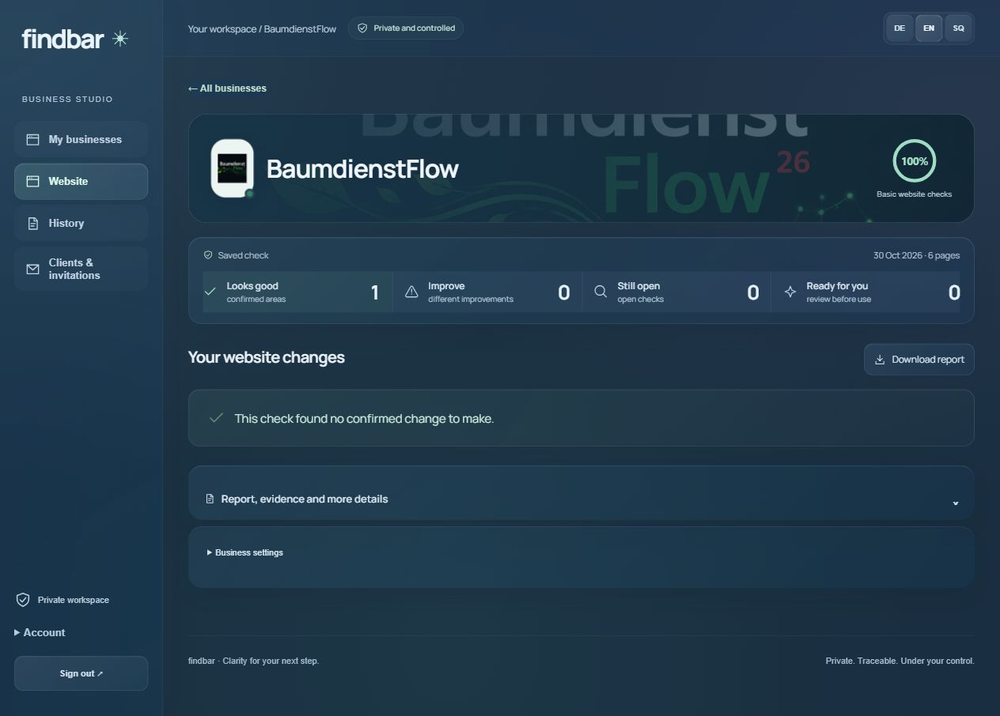
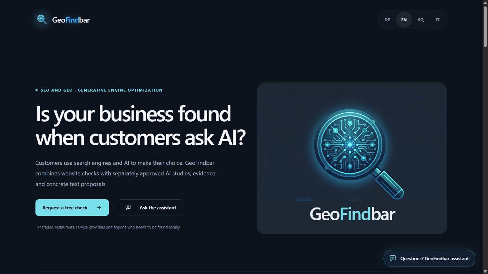
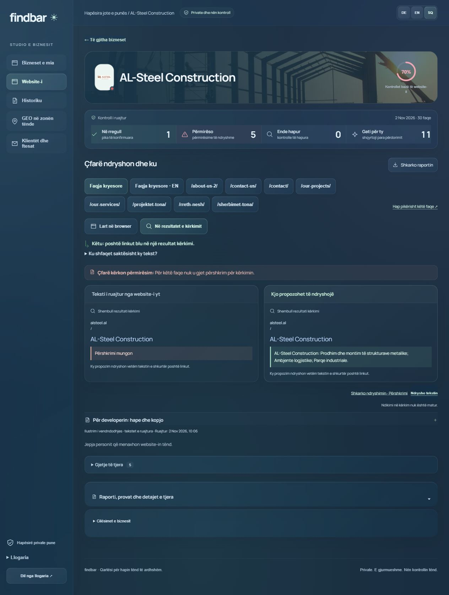
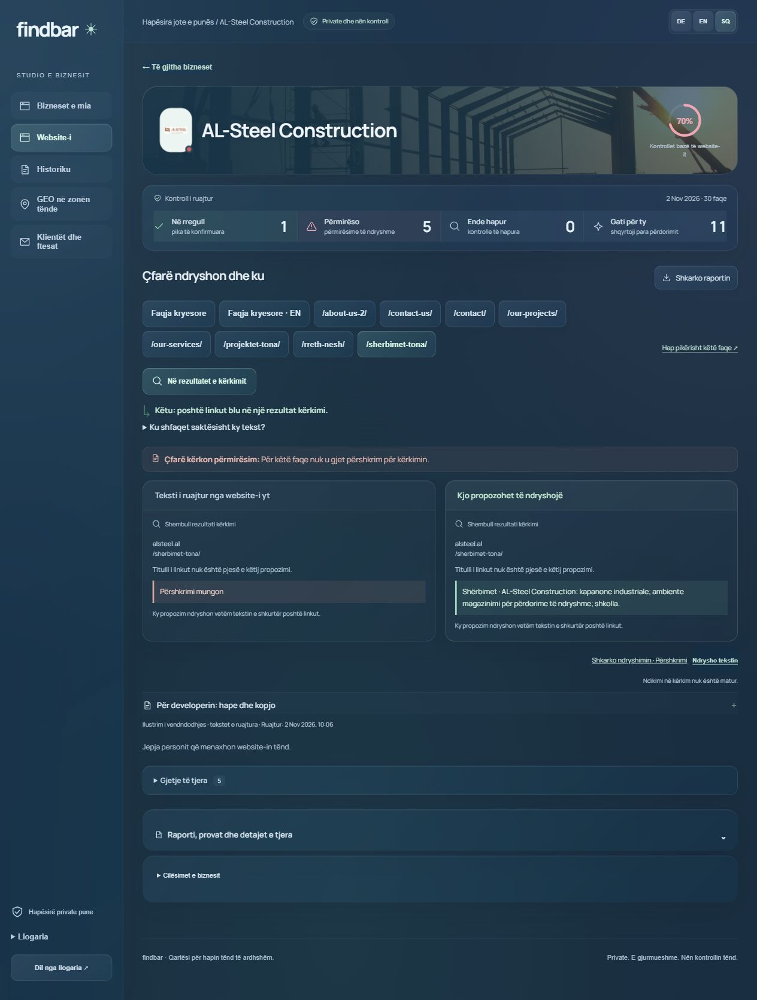
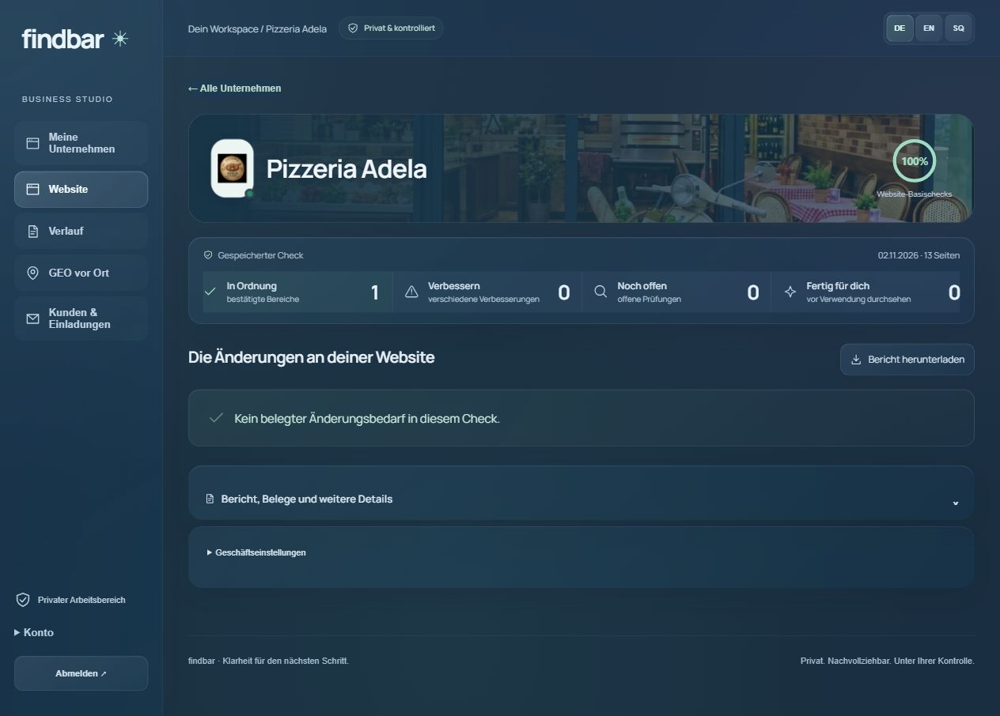
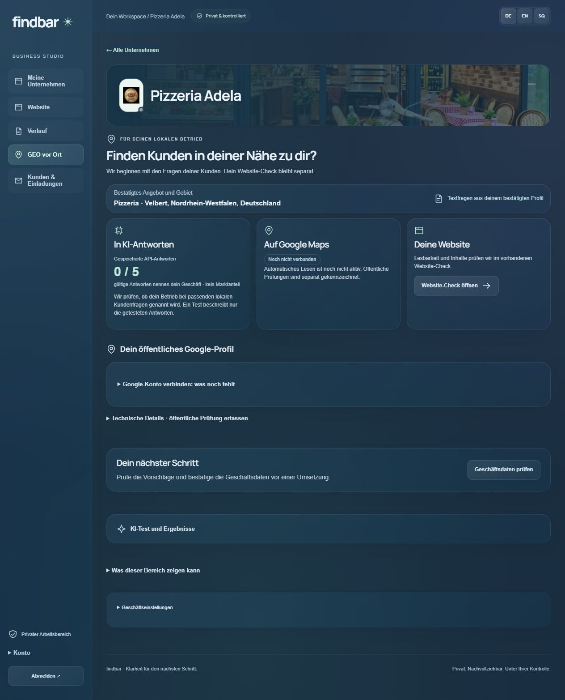
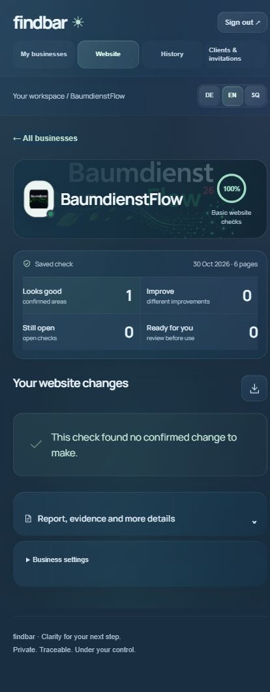

# GeoFindbar

**Your business. Clear findings. A concrete next step.**

A business audit studio by KiDraht. The operator performs the checks; the business confirms its details, reviews proposals and receives a clear report.

*Actual application, real saved result, published with permission. Six pages checked on 30 October 2026; no confirmed change under the covered website rules. Captured on 3 November 2026.*

## Buyer-answer engine · 13 November 2026

The new released engine uses the preserved KiDraht and Flow cases as executable regression fixtures for buyer enquiry, cost/activation and learning/demo boundaries. Eight historical before/after pairs produce 24 page-level review prompts on old snapshots and 0 on corrected snapshots. These are scoped review signals, separate from basic HTML scoring; no blind benchmark, fresh visibility measurement or automatic client-site change is claimed. Owner-approved PR20/source0710247 is deployed to the private Studio/worker; two fresh native KiDraht/Flow audits each checked10pages with0new buyer-review prompts. Original rows/keys/finances and paid-API restrictions remain preserved, as do intentional noindex/JS and Beta70/owner-UAT boundaries. [Released scope and evidence limits](docs/BUYER_ENGINE_CANDIDATE_20261113.md).

Owner-approved buyer-context v2 is now active in the Studio/worker. It removes7observed false alerts in the immutable BaumdienstFlow case while retaining the real setup/cost review. Three fresh native BaumdienstFlow/KiDraht/Flow audits returned5/0/0buyer-review prompts under the10-page limit, with original evidence/data and0paidAPI preserved. [Published scope and limits](docs/BUYER_CONTEXT_V2_20261114.md).

A subsequent BaumdienstFlow client-copy candidate clarifies quote/setup and demo boundaries. The original engine still flags3natural-language negation cases; this disagreement and the baseline remain preserved. Static publication is owner-approved and pending account authentication. [Case and limits](docs/BAUM_CLIENT_COPY_20261114.md).

A prospective frozen-rule BaumdienstFlow case now preserves the automatic findings, a separately sealed agent review and observed false alerts without retuning the engine. [Case and limits](docs/BAUMDIENSTFLOW_FROZEN_CASE_20261113.md).

A separate agent-assisted semantic comparison now reuses the same real-client questions and exact public-source captures. Reports remain private and model_assisted; automatic semantic inference and paid APIs are not activated. [Method and boundaries](docs/BUYER_ENGINE_CANDIDATE_20261113.md).

## FlowGastronomie as a real client · 13 November 2026

The owner-approved public website now gives four-language buyer answers and a labelled price/setup contact, while separating the demo from real payment/fiscal activation. Eight unchanged DE/SQ questions were genuinely searched and answered by the agent before/after; three private report versions parsed successfully. Two actual GeoFindbar audits each passed 60/60 basic HTML checks over 10 sampled pages, with zero native findings. The agent found the buyer gaps: this case demonstrates a coverage limit, not AI-visibility uplift. Original history, keys and finances are preserved. No paid API was activated or called. [Verified case and limits](docs/FLOW_CLIENT_20261113.md). Beta70/owner-UAT status remains unchanged; new demonstration assets are private review drafts.

## Owner-platform cycle · 13 November 2026

The public GeoFindbar website and the private Studio worker were updated after owner approval. Fresh audits through the actual online worker checked **8 GeoFindbar URLs** and respected the agreed **10-page limit for KiDraht**. Four localized legal pages are kept outside GeoFindbar's commercial website indicator. At that first recheck, KiDraht's intentional noindex boundary and unread JavaScript content remained explicit limitations; its separate correction was still pending at that point.

The original reports and history were preserved, with a new private backup and a comparison of all original rows across 32 tables. Two new audit records were added. No paid AI study or automatic schedule was activated. Ten earlier agent-assisted web-review answers remain separate from provider API measurements; this cycle does not establish ranking or AI-visibility uplift. Final owner UAT is still pending, and Beta/readiness 70 is unchanged.

*Actual public website, captured on 13 November 2026 after publication. This is the product presentation, not a screenshot of private customer data or an API measurement.*

## KiDraht as a real client · 13 November 2026

A subsequent owner-approved client correction was published on KiDraht: two labelled enquiry paths for new companies, three additional buyer FAQ answers in seven languages, clearer factual metadata and truthful XML/TXT responses. The same eight DE/SQ buyer questions were searched and answered by the agent before and after publication; candidate answers remain separate. The agent already knows the client, so this demonstrates source clarity rather than independent AI discovery or ranking uplift.

Fresh actual worker runs both remain partial: seven intentional noindex pages and three unassessed JavaScript shells, with no valid percentage. All seven live pages match the tested candidate; the 55-title catalogue, original private records/assets and financial/configuration boundaries are preserved. Full gate: TypeScript, 184 tests passed, two optional PostgreSQL fixture skips. No paid provider API was activated or called by this cycle. The before/candidate/after reports are three private source versions, not API-study records. Demo materials remain private review drafts; no new screenshots or owner acceptance are claimed.

## GeoFindbar · public domain · 9 November 2026

[GeoFindbar website](https://www.geofindbar.de/en.html) · [Deutsch](https://www.geofindbar.de/de.html) · [Shqip](https://www.geofindbar.de/sq.html) · [Italiano](https://www.geofindbar.de/it.html)

GeoFindbar is the owner-approved name for the existing SEO and GEO (Generative Engine Optimization) tool. The registered domain responds over HTTPS with a valid certificate. The public website keeps its own request form and website assistant, separately from the private Studio; it does not proxy the Studio APIs or customer reports. Studio access still requires the existing private-network/account controls.

Historical screenshots below retain the previous Findbar branding and their original dates. The rename does not imply a new audit, improved rankings or a change in pilot readiness. The brand refresh is published through [application PR11](https://github.com/IamRedi/findbar/pull/11). The [portfolio link migration, PR72](https://github.com/IamRedi/redion-portfolio-/pull/72), has also passed the independent KiDraht DNS/TLS and seven-language route checks. The owner approved both publications on 9 November 2026. PR11 and PR72 are merged; Railway and Vercel production deployments succeeded. The four-language public site and portfolio buttons passed live HTTPS checks and desktop/mobile review. The matching GitHub About/homepage is published; the private Studio runtime was not redeployed.

<!-- PRESENTATION_FIRST_PUBLICATION_76F8B3EAC1CF -->
## Public product website · 4 November 2026

At that publication, the [Findbar product website](https://redion.tailbdeaae.ts.net/findbar?lang=en) explained the studio before sign-in in DE/EN/SQ; the Italian portfolio opened English. The earlier four-language /about pages were retained as legacy information. Existing sign-in, reports and operator/client controls were preserved.

Verified on 4 November 2026 with packet `76f8b3eac1cf` and [portfolio PR29](https://github.com/IamRedi/redion-portfolio-/pull/29). Application capabilities, existing media, stage and readiness are unchanged.

## Three real businesses · three languages

| Business | Interface | Saved check | Result shown |
| --- | --- | --- | --- |
| AL-Steel Construction | Shqip | 2 November 2026 | Bounded 30-page check; 5 improvement topics and 11 proposals |
| Pizzeria Adela | Deutsch | 2 November 2026 | 13-page basic website check; separate 5-question AI study |
| BaumdienstFlow | English | 30 October 2026 | 6 pages; no confirmed change under the covered rules |

These screenshots show existing results in the current branded UI. Taking a new screenshot does not perform a new audit. The percentage counts basic website checks; it is not a Maps position, a complete audit or a measure of AI visibility.

## AL-Steel Construction · Shqip

Findbar tregon konkretisht çfarë mungon dhe çfarë teksti propozon. Kontrolli i ruajtur i 30 faqeve ka **5 lloje përmirësimesh dhe 11 propozime**. Propozimet përshkruajnë faqen përkatëse dhe mund t'i jepen zhvilluesit për shqyrtim e zbatim.

Propozimi konkret për faqen e shërbimeve

Mungon përshkrimi i shkurtër për kërkim. Propozimi tregon tekstin për atë fushë; titulli i madh brenda website-it mbetet i veçantë. Këto ndryshime ende nuk janë zbatuar në website-in real.

## Pizzeria Adela · Deutsch

Der gespeicherte Check umfasst **13 Seiten**. Innerhalb der abgedeckten Basisregeln gab es keine automatischen Befunde. Der ergänzende manuelle Review und die KI-Studie haben einen eigenen Umfang; 100% bedeutet keine vollständige Prüfung des Betriebs.

Die separate KI-Studie lieferte **keine Nennung in fünf API-Antworten**. Eine Antwort wich geografisch nach Essen ab. Diese begrenzte Momentaufnahme ist keine Maps-Platzierung oder Aussage über den gesamten Markt.

Gespeicherte KI-Studie ansehen

Die Aufnahme zeigt vorhandene Ergebnisse. Es wurde kein neuer KI-Test gestartet. Der interne Google-Business-Profile-Zugriff ist noch nicht verbunden; öffentliche Prüfungen bleiben separat.

[Deutsche Präsentation für lokale Betriebe](docs/PRAESENTATION_DE.md)

## BaumdienstFlow · English

The saved check covered **six pages** and found no confirmed change under the current website rules. Findbar retains that result and its date without inventing a problem or turning a basic-check percentage into a claim about the whole business.

Actual mobile view

## What GeoFindbar does

- Checks supported website issues with saved evidence: titles, search descriptions, repeated metadata and crawl/content rules.
- Shows the saved state beside a concrete proposal, with its exact field and copyable developer instructions.
- Performs scoped OpenAI web-search studies and read-only Google checks, with their limits kept separate from website findings.
- Provides private invitations, business confirmation and reviewed DE/EN/SQ reports, PDF export and an email draft.
- Preserves history, proposal versions and approvals. Client-site publication and paid requests have their own authorisation.

## Status · 3 November 2026

**Assisted pilot · Beta / readiness 70 · Owner UAT pending.**

Website checks, worker/DB, scoped OpenAI studies, ID-only Google lookup and mobile/desktop PageSpeed have been exercised. An earlier correction case completed the proposal → authorised implementation → fresh public recheck loop. The three cases above show their own saved results; no implementation or new measurement is implied by the screenshots.

Business logos and covers come from a reviewed catalogue. Automatic discovery is planned. Google Business Profile/Search Console access still needs the client's grant. Generic automatic customer-site publication is not connected.

The software verification baseline passed TypeScript, 240 unit tests, a production build and 51 isolated DB/worker checks. This presentation refresh reused saved results and made no new paid AI calls or changes to customer websites. Original reports and previous presentation versions remain in their history.

[English portfolio](https://www.redioncekrezi.de/en/projects/findbar) · [Portofoli shqip](https://www.redioncekrezi.de/sq/projects/findbar) · [Deutsches Portfolio](https://www.redioncekrezi.de/de/projects/findbar)

[by RediON](https://www.redioncekrezi.de/)
