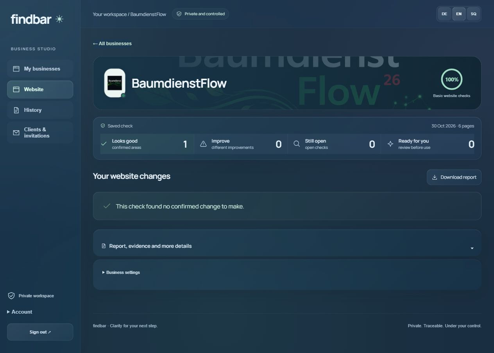
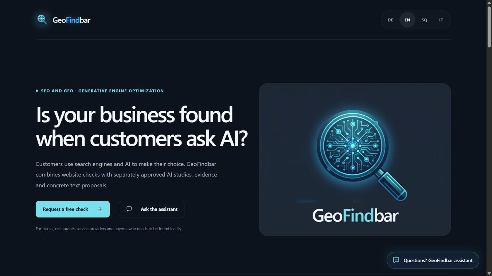
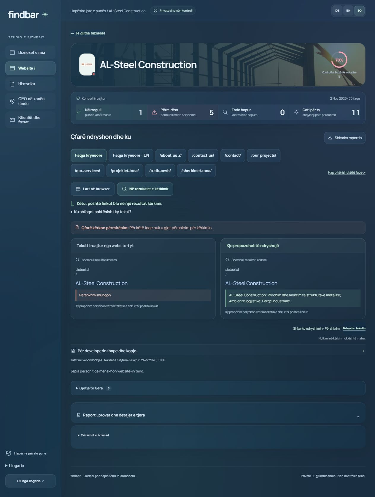
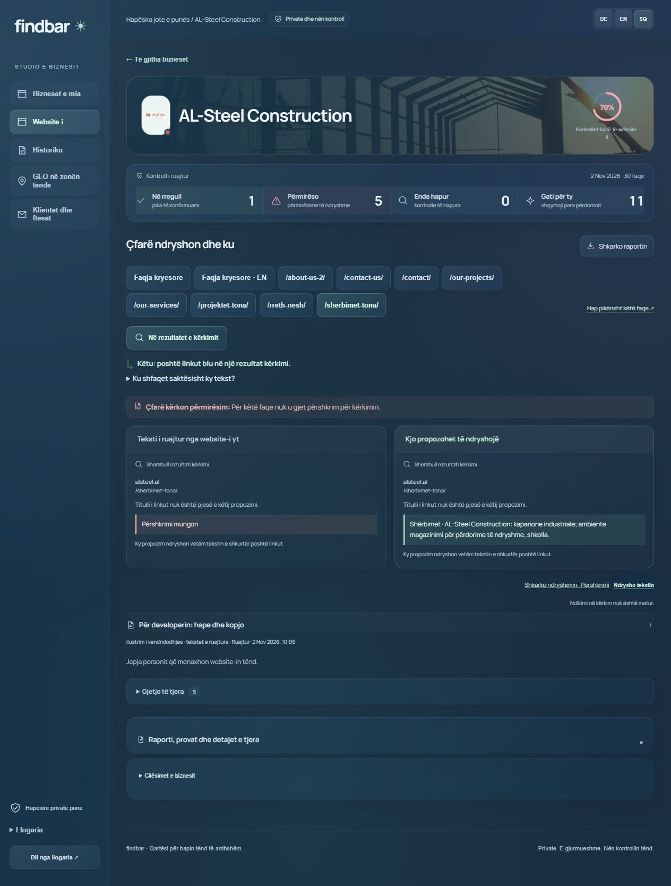
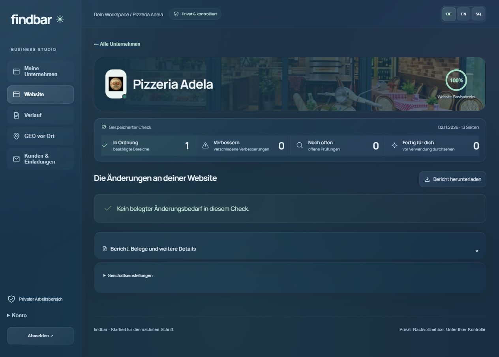
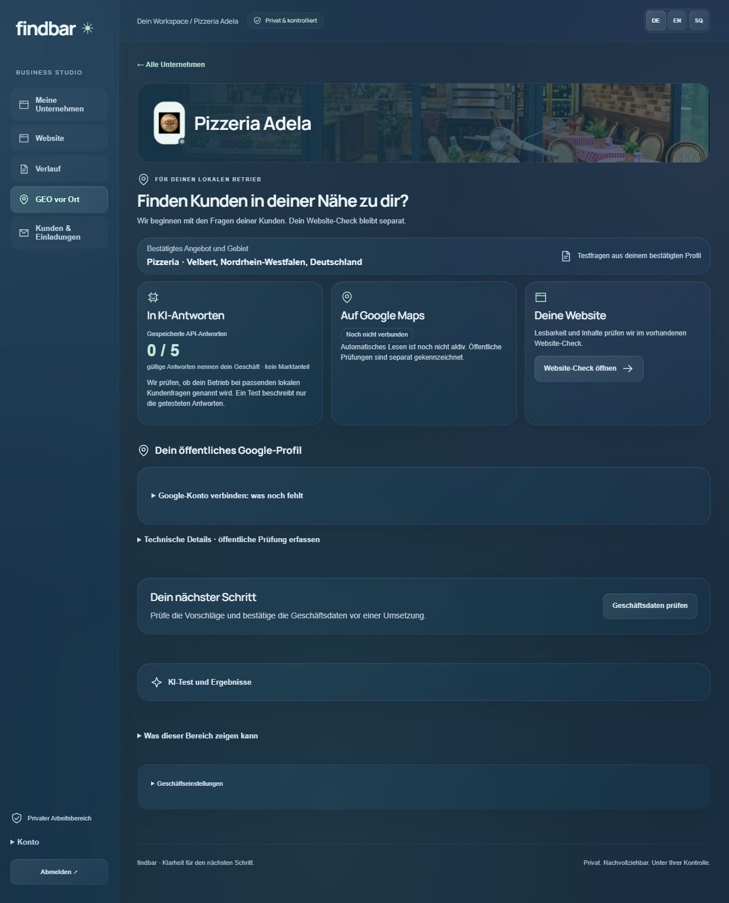
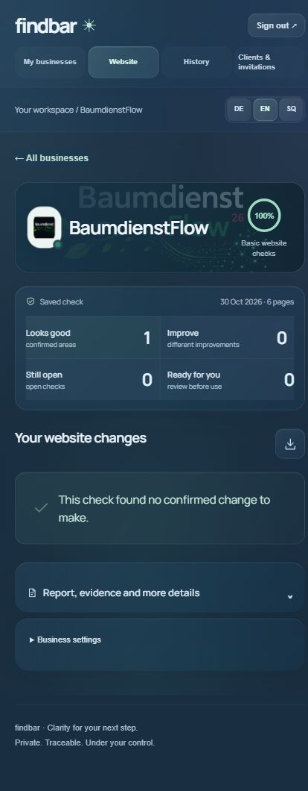

Prepared [automatic linked catalog discovery PR37](docs/CRAWL_DISCOVERY_20261116.md), review head f9f2fab96005128062a50f31a8c1a8d9f6a1d2b3.434unit/56integration/18E2E/build/security0 verified. Published engine remains PR36 and website PR33; originals/intended noindex preserved,paid API0. External-client material excluded. Native/About/card/media and assistedBeta70 NO_CONTENT_CHANGE. Candidate publication requires separate approval.

## Preserved publication and preparation history

Published and live native-rechecked [GeoFindbar PR36](docs/PR36_LIVE_20261115.md). Exact source f592591; original data/evidence and intended noindex preserved,no paid API. Public website PR33 and assistedBeta70 remain unchanged. Earlier candidate pending-publication states are historical.

## Preserved publication and preparation history

Prepared [PR36 content scope and equipment review candidate](docs/CONTENT_SCOPE_EQUIPMENT_20261115.md), exact head f592591b47558cbb5a53649342597ba53c7ae233. Final421unit/56integration/18E2E/build/security0 verified, originals and intended noindex preserved. Production remains PR35/websitePR33; no paid API. Private external-client material excluded. Assisted Beta70 and approved UI/media unchanged.

## Preserved publication and preparation history

Published and native-rechecked [GeoFindbar PR35](docs/PR35_LIVE_20261115.md). Original evidence/data and intended noindex are preserved; no paid API. Public site PR33 and assisted Beta70 remain unchanged. Earlier candidate pending-publication entries are historical.

## Preserved publication and preparation history

Prepared [bounded language and description review PR35](docs/CONTENT_QUALITY_CANDIDATE_20261115.md) with all local gates and owner-client regressions verified. Production remains PR34/PR33 pending separate Studio/worker publication approval. Original evidence/noindex and paid-API restrictions are preserved; assisted Beta70 and approved public media are unchanged.

## Preserved publication and preparation history

Published and live-verified [GeoFindbar PR32/PR33](docs/PR32_PR33_LIVE_20261115.md), with the small PR34 German text correction. Same original nine page bodies: five false enquiry reviews to zero. Free evidenced report and a three-step enquiry are public; original data/proof are preserved and paid APIs remain off. Assisted Beta70 is unchanged.

## Preserved preparation and publication history

Prepared [private form/alias and free-report candidates](docs/FORMS_ALIAS_FREE_CHECK_20261115.md) for review in PR32/PR33. Original evidence and database backups are preserved; current production and assisted Beta70 are unchanged. No paid API.

## Preserved real-test and publication history

Real [self-client recheck after PR31](docs/SELF_PR31_RECHECK_20261115.md) completed with original evidence preserved. The native report retains5raw enquiry reviews; browser/assistant checks distinguish extraction limits from business defects. No engine/site change or paid API.

## Preserved publication and earlier test history

Published and verified [GeoFindbar app-style website PR31](docs/PR31_WEBSITE_LIVE_20261115.md). Original data/proof are preserved; paid APIs remain off. Assisted Beta70 and core audit scope are unchanged.

## Preserved private preparation and publication history

Prepared [private app-style website candidate](docs/GFB_WORKSPACE_UI_PRIVATE_20261115.md) for review. The published PR30 website, approved public media and assisted Beta70 remain unchanged. No deployment or paid API activation.

## Preserved published baseline and history

Published [website and enquiry release](docs/PR30_WEBSITE_LIVE_20261115.md), verified live with original data preserved and paid APIs off. Assisted Beta70 and core audit scope are unchanged.

## Preserved private preparation and prior accepted history

Private [website integration candidate](docs/GFB_SITE_PRIVATE_CD_20261115.md) prepared for review; production, approved media and readiness are unchanged. No deployment or paid API activation.

Latest [approved self-client engine and offer release](docs/SELF_CLIENT_LIVE_20261115.md): actual native12-to4-to0reviews, original evidence preserved, public offer clarified. No paid API, ranking or readiness uplift.

## Preserved earlier release history

Latest [approved restaurant-review release](docs/PR27_RESTAURANT_LIVE_20261115.md): PR27 is live in Studio/worker;five native client rechecks,wood protection and immutable before/after regression verified. No paid API or ranking/readiness uplift.

## Earlier candidate preparation and retained milestone history

Prepared [restaurant review candidate](docs/RESTAURANT_REVIEW_CANDIDATE_20261114.md): real before/after regression and full local gates verified; exact Studio/worker publication awaits approval. Current runtime remains PR26. No ranking/readiness uplift or new public customer media.

Latest [approved PR26 engine publication](docs/PR26_INDEXING_LIVE_20261114.md): Studio/worker is live;wood and four real-client rechecks retain intentional noindex and original evidence.26HTML bodies match preserved baselines. No ranking/readiness uplift claimed.

## Restaurant-client validation · 14 November 2026

A known restaurant pilot completed frozen-rule, actual native before/after audits
and a separately authorised website metadata enhancement. Ten-page samples remain
partial with0static findings; four locales now expose fact-derived Restaurant
data. The assistant identified this opportunity; the business engine does not
yet recommend it automatically. No paid API calls or Google/AI visibility uplift
claimed. Existing assisted Beta70 scope and public media remain unchanged.
[Verified scope and remaining boundary](docs/RESTAURANT_CLIENT_BOUNDARY_20261114.md).

## Preserved earlier milestone history

Latest [approved PR25 engine publication](docs/PR25_CONTEXT_LIVE_20261114.md): Studio/worker is live; four native client audits and one demo component recheck retain context evidence and manual-review limits. No ranking or readiness uplift claimed.

## Preserved preparation and earlier milestone history

Latest [demo-purpose/context candidate](docs/DEMO_PURPOSE_CONTEXT_CANDIDATE_20261114.md): exact-source checks and real-client replay verified; PR25 awaits publication approval. Live engine remains unchanged. No ranking/readiness uplift claimed.

## Previous completed milestone history

Latest [approved BaumdienstFlow demo publication](docs/PR202_DEMO_LIVE_20261114.md): pinned source is live; frozen native before/after and data preservation verified. Intentional demo noindex is kept separate from marketing. No ranking/readiness or public media claim.

Historical preparation: Latest [pinned demo release verification](docs/PR202_RELEASE_READY_20261114.md): remaining local gates PASS;exact-source app publication awaits separate owner approval. Static publication remains live. No new capability/readiness or public media claim.

## Earlier milestone history

Latest verified milestone: [approved static publication and pinned demo test repair](docs/PR200_STATIC_LIVE_AND_BAUM_REPAIR_20261114.md). StaticFAQ live;native crawler evidence partial;repaired local gates PASS,app candidate not deployed. No ranking/readiness uplift claimed.

## Earlier verification history

Latest [full demo verification](docs/DEMO_FULL_QA_20261114.md): static candidate unchanged; application release gates and reproduced baseline failures recorded. Draft preparation only; no new deployment or readiness increase.

# GeoFindbar

**Your business. Clear findings. A concrete next step.**

A business audit studio by KiDraht. The operator performs the checks; the business confirms its details, reviews proposals and receives a clear report.

*Actual application, real saved result, published with permission. Six pages checked on 30 October 2026; no confirmed change under the covered website rules. Captured on 3 November 2026.*

The [published v4 engine](docs/BUYER_TOPIC_SCOPE_V4_20261114.md) now reviews absent buyer topics and separates confirmed products sharing a domain. Four actual native rechecks preserve clear corrected buyer answers and distinct BauFlow/Baum samples; the active module flags five immutable historical missing-cost editions. Original evidence/data and paid-API restrictions remain preserved; conservative scope and visibility/readiness limits remain explicit.

The [identity correction and DE/AL website updates](docs/IDENTITY_MARKETS_20261114.md) are now published and native rechecked. Four engine rechecks preserve27matched captures and quarantine5uncertain identities;two further website audits sample6pages each with0findings. Essen/NRW and Tirana are explicit software target markets. No ranking,independent-discovery or AI visibility uplift is claimed.

An [actual Google/AI client visibility sample](docs/GOOGLE_AI_VISIBILITY_20261114.md) confirms that both product URLs appear in Google,while AI entity conflation and Tirana discovery gaps remain. Secondary web-tool absence disagrees with directGoogle and is not noindexing evidence. This is a read-only measured sample,no automatic engine rule or ranking uplift claim.

A [guarded product identity candidate](docs/PUBLIC_PRODUCT_SEPARATION_20261114.md) follows the real Google/AI case. Public copy is tested;demo patch configuration checks passed while full application release gates remain pending. The info-domain proposal requires ownership/TLS verification. Nothing in this candidate is published and no ranking uplift is claimed.

## Buyer-answer engine · 13 November 2026

The new released engine uses the preserved KiDraht and Flow cases as executable regression fixtures for buyer enquiry, cost/activation and learning/demo boundaries. Eight historical before/after pairs produce 24 page-level review prompts on old snapshots and 0 on corrected snapshots. These are scoped review signals, separate from basic HTML scoring; no blind benchmark, fresh visibility measurement or automatic client-site change is claimed. Owner-approved PR20/source0710247 is deployed to the private Studio/worker; two fresh native KiDraht/Flow audits each checked10pages with0new buyer-review prompts. Original rows/keys/finances and paid-API restrictions remain preserved, as do intentional noindex/JS and Beta70/owner-UAT boundaries. [Released scope and evidence limits](docs/BUYER_ENGINE_CANDIDATE_20261113.md).

Owner-approved buyer-context v2 is now active in the Studio/worker. It removes7observed false alerts in the immutable BaumdienstFlow case while retaining the real setup/cost review. Three fresh native BaumdienstFlow/KiDraht/Flow audits returned5/0/0buyer-review prompts under the10-page limit, with original evidence/data and0paidAPI preserved. [Published scope and limits](docs/BUYER_CONTEXT_V2_20261114.md).

The [BauFlow/AL-Steel client cycle](docs/BAUFLOW_CLIENT_GEO_20261114.md) is published and native rechecked:0→0reviewprompts,but5costchecks move from not_applicable to explicit;agentanswers2/4/2→4/2/2. Missing-topic applicability and cross-product crawl limits remain documented;no visibility or readiness uplift claimed.

The DE/EN wording correction is now published in Studio/worker. Three actual native rechecks returned Baum3→0 buyer prompts,KiDraht0→0,Flow0→0,with all30HTMLhashes unchanged. [Published v3 case and limits](docs/BUYER_NEGATION_V3_20261114.md). Readiness and public media remain unchanged.

BaumdienstFlow quote/setup copy is now public; the frozen native GeoFindbar before/live-after cycle returned5→3reviewprompts. The remaining DE/ENnegation disagreement is preserved; numerical price and independent discovery remain limited. [Published case and limits](docs/BAUM_CLIENT_COPY_20261114.md).

A prospective frozen-rule BaumdienstFlow case now preserves the automatic findings, a separately sealed agent review and observed false alerts without retuning the engine. [Case and limits](docs/BAUMDIENSTFLOW_FROZEN_CASE_20261113.md).

A separate agent-assisted semantic comparison now reuses the same real-client questions and exact public-source captures. Reports remain private and model_assisted; automatic semantic inference and paid APIs are not activated. [Method and boundaries](docs/BUYER_ENGINE_CANDIDATE_20261113.md).

## FlowGastronomie as a real client · 13 November 2026

The owner-approved public website now gives four-language buyer answers and a labelled price/setup contact, while separating the demo from real payment/fiscal activation. Eight unchanged DE/SQ questions were genuinely searched and answered by the agent before/after; three private report versions parsed successfully. Two actual GeoFindbar audits each passed 60/60 basic HTML checks over 10 sampled pages, with zero native findings. The agent found the buyer gaps: this case demonstrates a coverage limit, not AI-visibility uplift. Original history, keys and finances are preserved. No paid API was activated or called. [Verified case and limits](docs/FLOW_CLIENT_20261113.md). Beta70/owner-UAT status remains unchanged; new demonstration assets are private review drafts.

## Owner-platform cycle · 13 November 2026

The public GeoFindbar website and the private Studio worker were updated after owner approval. Fresh audits through the actual online worker checked **8 GeoFindbar URLs** and respected the agreed **10-page limit for KiDraht**. Four localized legal pages are kept outside GeoFindbar's commercial website indicator. At that first recheck, KiDraht's intentional noindex boundary and unread JavaScript content remained explicit limitations; its separate correction was still pending at that point.

The original reports and history were preserved, with a new private backup and a comparison of all original rows across 32 tables. Two new audit records were added. No paid AI study or automatic schedule was activated. Ten earlier agent-assisted web-review answers remain separate from provider API measurements; this cycle does not establish ranking or AI-visibility uplift. Final owner UAT is still pending, and Beta/readiness 70 is unchanged.

*Actual public website, captured on 13 November 2026 after publication. This is the product presentation, not a screenshot of private customer data or an API measurement.*

## KiDraht as a real client · 13 November 2026

A subsequent owner-approved client correction was published on KiDraht: two labelled enquiry paths for new companies, three additional buyer FAQ answers in seven languages, clearer factual metadata and truthful XML/TXT responses. The same eight DE/SQ buyer questions were searched and answered by the agent before and after publication; candidate answers remain separate. The agent already knows the client, so this demonstrates source clarity rather than independent AI discovery or ranking uplift.

Fresh actual worker runs both remain partial: seven intentional noindex pages and three unassessed JavaScript shells, with no valid percentage. All seven live pages match the tested candidate; the 55-title catalogue, original private records/assets and financial/configuration boundaries are preserved. Full gate: TypeScript, 184 tests passed, two optional PostgreSQL fixture skips. No paid provider API was activated or called by this cycle. The before/candidate/after reports are three private source versions, not API-study records. Demo materials remain private review drafts; no new screenshots or owner acceptance are claimed.

## GeoFindbar · public domain · 9 November 2026

[GeoFindbar website](https://www.geofindbar.de/en.html) · [Deutsch](https://www.geofindbar.de/de.html) · [Shqip](https://www.geofindbar.de/sq.html) · [Italiano](https://www.geofindbar.de/it.html)

GeoFindbar is the owner-approved name for the existing SEO and GEO (Generative Engine Optimization) tool. The registered domain responds over HTTPS with a valid certificate. The public website keeps its own request form and website assistant, separately from the private Studio; it does not proxy the Studio APIs or customer reports. Studio access still requires the existing private-network/account controls.

Historical screenshots below retain the previous Findbar branding and their original dates. The rename does not imply a new audit, improved rankings or a change in pilot readiness. The brand refresh is published through [application PR11](https://github.com/IamRedi/findbar/pull/11). The [portfolio link migration, PR72](https://github.com/IamRedi/redion-portfolio-/pull/72), has also passed the independent KiDraht DNS/TLS and seven-language route checks. The owner approved both publications on 9 November 2026. PR11 and PR72 are merged; Railway and Vercel production deployments succeeded. The four-language public site and portfolio buttons passed live HTTPS checks and desktop/mobile review. The matching GitHub About/homepage is published; the private Studio runtime was not redeployed.

<!-- PRESENTATION_FIRST_PUBLICATION_76F8B3EAC1CF -->
## Public product website · 4 November 2026

At that publication, the [Findbar product website](https://redion.tailbdeaae.ts.net/findbar?lang=en) explained the studio before sign-in in DE/EN/SQ; the Italian portfolio opened English. The earlier four-language /about pages were retained as legacy information. Existing sign-in, reports and operator/client controls were preserved.

Verified on 4 November 2026 with packet `76f8b3eac1cf` and [portfolio PR29](https://github.com/IamRedi/redion-portfolio-/pull/29). Application capabilities, existing media, stage and readiness are unchanged.

## Three real businesses · three languages

| Business | Interface | Saved check | Result shown |
| --- | --- | --- | --- |
| AL-Steel Construction | Shqip | 2 November 2026 | Bounded 30-page check; 5 improvement topics and 11 proposals |
| Pizzeria Adela | Deutsch | 2 November 2026 | 13-page basic website check; separate 5-question AI study |
| BaumdienstFlow | English | 30 October 2026 | 6 pages; no confirmed change under the covered rules |

These screenshots show existing results in the current branded UI. Taking a new screenshot does not perform a new audit. The percentage counts basic website checks; it is not a Maps position, a complete audit or a measure of AI visibility.

## AL-Steel Construction · Shqip

Findbar tregon konkretisht çfarë mungon dhe çfarë teksti propozon. Kontrolli i ruajtur i 30 faqeve ka **5 lloje përmirësimesh dhe 11 propozime**. Propozimet përshkruajnë faqen përkatëse dhe mund t'i jepen zhvilluesit për shqyrtim e zbatim.

Propozimi konkret për faqen e shërbimeve

Mungon përshkrimi i shkurtër për kërkim. Propozimi tregon tekstin për atë fushë; titulli i madh brenda website-it mbetet i veçantë. Këto ndryshime ende nuk janë zbatuar në website-in real.

## Pizzeria Adela · Deutsch

Der gespeicherte Check umfasst **13 Seiten**. Innerhalb der abgedeckten Basisregeln gab es keine automatischen Befunde. Der ergänzende manuelle Review und die KI-Studie haben einen eigenen Umfang; 100% bedeutet keine vollständige Prüfung des Betriebs.

Die separate KI-Studie lieferte **keine Nennung in fünf API-Antworten**. Eine Antwort wich geografisch nach Essen ab. Diese begrenzte Momentaufnahme ist keine Maps-Platzierung oder Aussage über den gesamten Markt.

Gespeicherte KI-Studie ansehen

Die Aufnahme zeigt vorhandene Ergebnisse. Es wurde kein neuer KI-Test gestartet. Der interne Google-Business-Profile-Zugriff ist noch nicht verbunden; öffentliche Prüfungen bleiben separat.

[Deutsche Präsentation für lokale Betriebe](docs/PRAESENTATION_DE.md)

## BaumdienstFlow · English

The saved check covered **six pages** and found no confirmed change under the current website rules. Findbar retains that result and its date without inventing a problem or turning a basic-check percentage into a claim about the whole business.

Actual mobile view

## What GeoFindbar does

- Checks supported website issues with saved evidence: titles, search descriptions, repeated metadata and crawl/content rules.
- Shows the saved state beside a concrete proposal, with its exact field and copyable developer instructions.
- Performs scoped OpenAI web-search studies and read-only Google checks, with their limits kept separate from website findings.
- Provides private invitations, business confirmation and reviewed DE/EN/SQ reports, PDF export and an email draft.
- Preserves history, proposal versions and approvals. Client-site publication and paid requests have their own authorisation.

## Status · 3 November 2026

**Assisted pilot · Beta / readiness 70 · Owner UAT pending.**

Website checks, worker/DB, scoped OpenAI studies, ID-only Google lookup and mobile/desktop PageSpeed have been exercised. An earlier correction case completed the proposal → authorised implementation → fresh public recheck loop. The three cases above show their own saved results; no implementation or new measurement is implied by the screenshots.

Business logos and covers come from a reviewed catalogue. Automatic discovery is planned. Google Business Profile/Search Console access still needs the client's grant. Generic automatic customer-site publication is not connected.

The software verification baseline passed TypeScript, 240 unit tests, a production build and 51 isolated DB/worker checks. This presentation refresh reused saved results and made no new paid AI calls or changes to customer websites. Original reports and previous presentation versions remain in their history.

[English portfolio](https://www.redioncekrezi.de/en/projects/findbar) · [Portofoli shqip](https://www.redioncekrezi.de/sq/projects/findbar) · [Deutsches Portfolio](https://www.redioncekrezi.de/de/projects/findbar)

[by RediON](https://www.redioncekrezi.de/)
