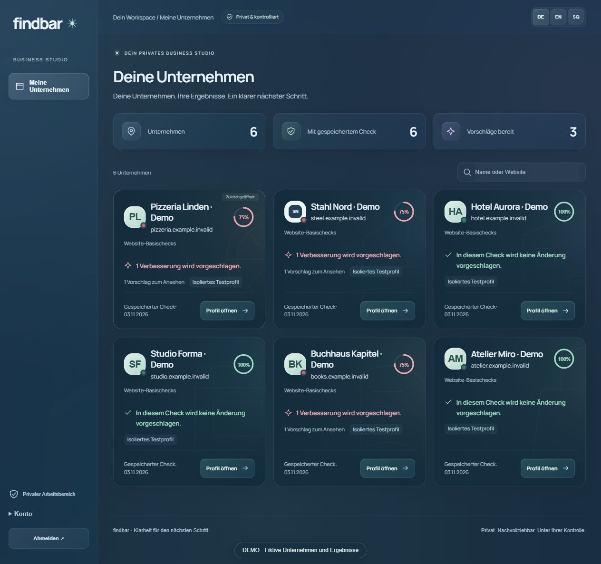
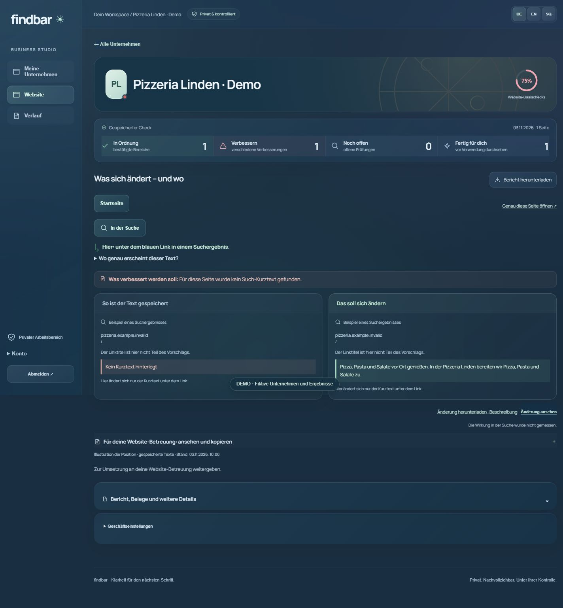
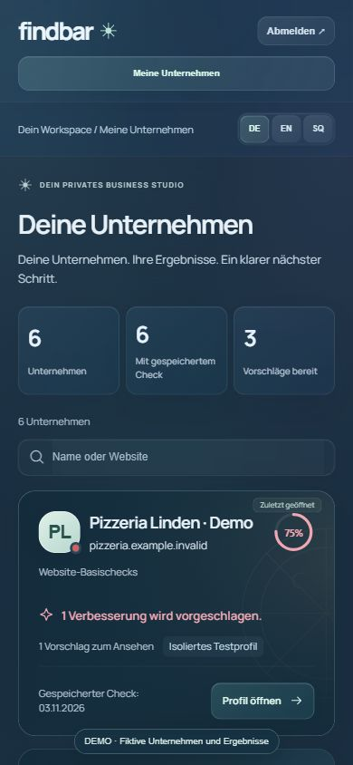

# Findbar für Pizzerien und lokale Betriebe

**Was stimmt auf Ihrer Website — und was lässt sich konkret verbessern?**

Sie führen Ihre Pizzeria. Wir prüfen Ihren Auftritt im Netz und zeigen Ihnen verständlich, wo Handlungsbedarf besteht. Sie erhalten klare Prioritäten und konkrete Vorschläge für die Person, die Ihre Website betreut.

*Echte Findbar-Oberfläche mit fiktiven Unternehmen und Beispielergebnissen. Pizzeria Linden ist ein Demonstrationsbetrieb.*

## Ein Beispiel, das sich sofort verstehen lässt

In unserer Demo fehlt auf einer Seite der kurze Beschreibungstext für Suchmaschinen. Findbar zeigt den gespeicherten Zustand links und den konkreten Textvorschlag rechts. Der große Text innerhalb der Website wird dadurch nicht geändert.

Die Website-Betreuung kann die genaue Seite, das betroffene Feld und den vorgeschlagenen Text ansehen und kopieren. Änderungen werden vor der Veröffentlichung geprüft und freigegeben.

## So läuft die Zusammenarbeit

1. **Sie bestätigen Ihren Betrieb.** Über einen privaten Link prüfen Sie die bekannten Angaben und geben die Prüfung frei.
2. **Wir prüfen und ordnen ein.** Website und öffentlich prüfbare lokale Angaben werden untersucht. Auf Wunsch werden separat freigegebene KI-Studien vorbereitet.
3. **Sie erhalten ein klares Ergebnis.** Was funktioniert? Was sollte verbessert werden? Welche Schritte sind zuerst sinnvoll? Der geprüfte Bericht lässt sich als PDF herunterladen.
4. **Sie entscheiden über die Umsetzung.** Die Website-Betreuung erhält konkrete Anweisungen. Nach einer freigegebenen Änderung wird erneut geprüft.

Sie müssen keine Prompts schreiben oder technische Einstellungen verwalten.

## Was Findbar prüft

- **Ihre Website:** unter anderem Seitentitel, Suchbeschreibungen, wiederholte Seitentitel und Beschreibungen und unterstützte technische Auffälligkeiten — mit Belegen.
- **Öffentliche lokale Präsenz:** Findbar kann einen passenden öffentlichen Google-Eintrag suchen und die Geschwindigkeit Ihrer Website auf Smartphone und Desktop prüfen. Diese Ergebnisse werden gesondert gezeigt.
- **Ausgewählte KI-Antworten:** ob Ihr Betrieb in einem freigegebenen Fragenpaket erwähnt oder als Quelle genannt wird. Anbieter, Umfang und Budget werden vorher festgelegt.

## Ein Ergebnis, das Sie weitergeben können

Der Bericht benennt verständlich, was gut ist und was verbessert werden sollte. Konkrete Textvorschläge und die zugehörigen Belege bleiben nachvollziehbar. PDF und E-Mail-Entwurf stehen bereit; es wird keine E-Mail automatisch versendet.

Mobile Ansicht

Aktueller Pilot und Grenzen

Findbar läuft als betreuter Pilot. Der Betreiber führt die Prüfungen aus; das Unternehmen bestätigt Angaben und erhält den geprüften Bericht. Zugriffe auf interne Google-Business-Profile- oder Search-Console-Daten sind noch nicht live angebunden und brauchen die entsprechende Kundenfreigabe.

Eine Website-Basis-Prozentzahl zählt die ausgeführten Prüfungen. Sie ist keine Google-Position oder allgemeine Bewertung Ihres Betriebs. Eine kleine KI-Studie ist eine Momentaufnahme ausgewählter Antworten; sie garantiert keine Sichtbarkeit oder zusätzlichen Gäste. Findbar veröffentlicht Änderungen auf Kundenwebsites nicht automatisch.

[Zur Produktpräsentation im Portfolio](https://www.redioncekrezi.de/de/projects/findbar) · [English](../README.md) · [Shqip](../README.md#demonstrim-në-shqip)
